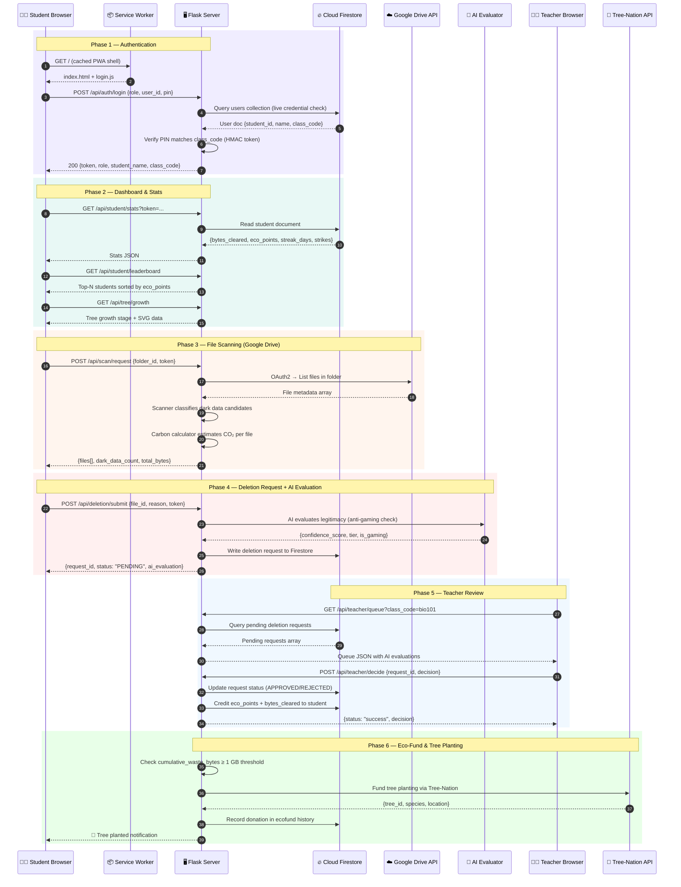
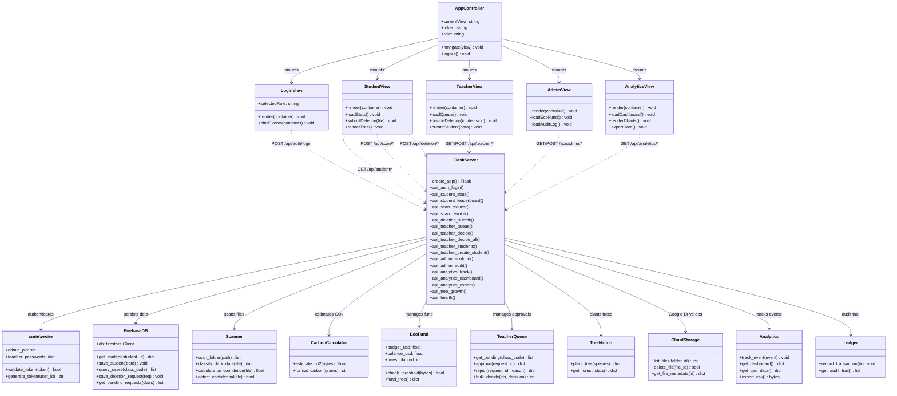
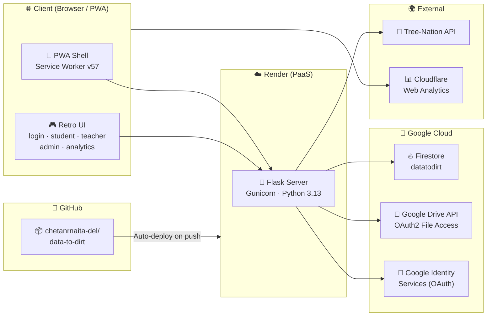

# Data-to-Dirt — Full Application Architecture

## 1. System Waterfall / Sequence Diagram

This sequence diagram shows the **end-to-end lifecycle** of a student interacting with the platform — from login to tree planting.

> 📥 **Rendered Image Formats:**
> - [View / Download High-Res PNG (1892x2537)](file:///Users/narayan/.gemini/antigravity/scratch/data-to-dirt/docs/diagrams/waterfall_sequence_diagram.png)
> - [View / Download High-Quality JPG (1892x2537)](file:///Users/narayan/.gemini/antigravity/scratch/data-to-dirt/docs/diagrams/waterfall_sequence_diagram.jpg)
> - [View / Download Vector SVG](file:///Users/narayan/.gemini/antigravity/scratch/data-to-dirt/docs/diagrams/waterfall_sequence_diagram.svg)

---

## 2. Component / Class Diagram (UML)

> 📥 **Rendered Image Formats:**
> - [View / Download High-Res PNG (1904x842)](file:///Users/narayan/.gemini/antigravity/scratch/data-to-dirt/docs/diagrams/uml_class_diagram.png)
> - [View / Download High-Quality JPG (1904x842)](file:///Users/narayan/.gemini/antigravity/scratch/data-to-dirt/docs/diagrams/uml_class_diagram.jpg)
> - [View / Download Vector SVG](file:///Users/narayan/.gemini/antigravity/scratch/data-to-dirt/docs/diagrams/uml_class_diagram.svg)

---

## 3. Deployment Architecture

> 📥 **Rendered Image Formats:**
> - [View / Download High-Res PNG (1070x693)](file:///Users/narayan/.gemini/antigravity/scratch/data-to-dirt/docs/diagrams/deployment_architecture_diagram.png)
> - [View / Download High-Quality JPG (1070x693)](file:///Users/narayan/.gemini/antigravity/scratch/data-to-dirt/docs/diagrams/deployment_architecture_diagram.jpg)
> - [View / Download Vector SVG](file:///Users/narayan/.gemini/antigravity/scratch/data-to-dirt/docs/diagrams/deployment_architecture_diagram.svg)

---

## 4. Data Flow Waterfall (Phase Summary)

| Phase | Actor | Action | Backend Service | Storage |
|-------|-------|--------|-----------------|---------|
| **1. Auth** | Student / Teacher / Admin | Login with credentials | `AuthService` | Firestore `users` |
| **2. Dashboard** | Student | View stats, leaderboard, tree | `FlaskServer` | Firestore + `app_state.json` |
| **3. Scan** | Student | Select Google Drive folder → scan | `Scanner` + `CloudStorage` | Google Drive API |
| **4. Submit** | Student | Request file deletion with reason | `AI Evaluator` + `TeacherQueue` | Firestore `deletion_requests` |
| **5. Review** | Teacher | Approve / reject deletion requests | `TeacherQueue` | Firestore |
| **6. Credit** | System | Award eco-points, update streak | `CarbonCalculator` + `Ledger` | Firestore `users` |
| **7. Eco-Fund** | System | Check threshold → fund tree | `EcoFund` + `TreeNation` | Firestore `ecofund` |
| **8. Analytics** | Admin | View global KPIs, geo heatmap | `Analytics` | Firestore `analytics` |
